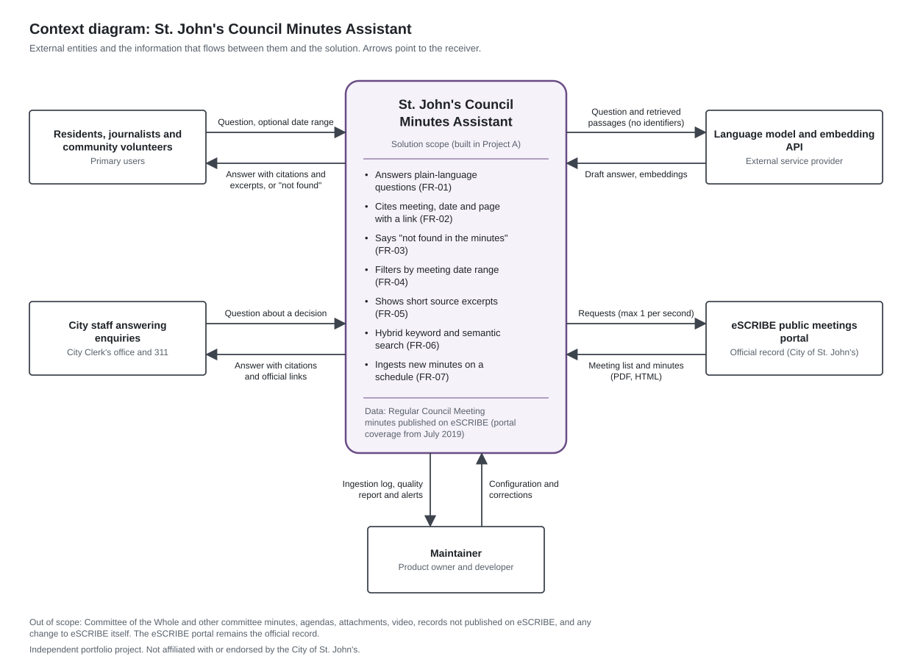
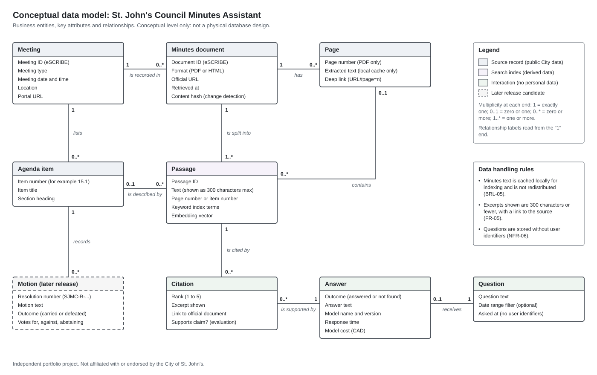

# Business Requirements Document: St. John's Council Minutes Assistant

> **Independent portfolio project.** Not affiliated with or endorsed by the City of St. John's. Source documents are © City of St. John's and are retrieved from the City's public meetings portal; this repository does not redistribute them.

> **Status of this analysis.** This document is based on public information and document analysis carried out on 17 October 2026. No stakeholder interviews or workshops have been held. Every statement about City processes, enquiry volumes or stakeholder needs that could not be observed publicly is marked as an assumption to validate with stakeholders. Section 5.5 sets out the elicitation plan that would confirm or correct them.

## Document control

| Item | Value |
|---|---|
| Document | Business Requirements Document (BRD) |
| Document ID | CMA-BA-01 |
| Product | St. John's Council Minutes Assistant |
| Version | 0.9 (complete draft for stakeholder validation) |
| Status | Draft, not baselined |
| Author | Mostafa Rafiur Wasib (business analyst) |
| Date | 17 October 2026 |
| Proposed approvers | Business sponsor, product owner, City Clerk's office representative, ATIPP Coordinator (see section 17) |
| Related documents | [02-user-stories.md](02-user-stories.md) (CMA-BA-02), [03-uat-test-plan.md](03-uat-test-plan.md) (CMA-BA-03), [04-traceability-matrix.md](04-traceability-matrix.md) (CMA-BA-04), implementation: [stjohns-council-minutes-rag](https://github.com/mrw-soumik/stjohns-council-minutes-rag) (Project A) |
| Method | BABOK Guide v3 requirements classification: business, stakeholder, solution (functional and non-functional) and transition requirements |

**Version history**

| Version | Date | Author | Change |
|---|---|---|---|
| 0.9 | 2026-10-17 | Mostafa Rafiur Wasib | Complete draft based on public information and document analysis. Elicitation sessions not yet held. |

The next version (1.0) is the baseline, issued after the validation activities in section 5.5 and sign-off in section 17.

<!-- toc -->
**Contents**

1. [Executive summary](#1-executive-summary)
2. [Background and problem statement](#2-background-and-problem-statement)
3. [Business objectives and success measures](#3-business-objectives-and-success-measures)
4. [Scope](#4-scope)
5. [Stakeholder analysis](#5-stakeholder-analysis)
6. [Personas](#6-personas)
7. [Current state](#7-current-state)
8. [Future state](#8-future-state)
9. [Requirements](#9-requirements)
10. [Data requirements and conceptual data model](#10-data-requirements-and-conceptual-data-model)
11. [Business rules](#11-business-rules)
12. [Transition requirements](#12-transition-requirements)
13. [Assumptions, constraints and dependencies](#13-assumptions-constraints-and-dependencies)
14. [Risks and mitigations](#14-risks-and-mitigations)
15. [Open questions for stakeholders](#15-open-questions-for-stakeholders)
16. [Glossary](#16-glossary)
17. [Sign-off](#17-sign-off)
18. [Appendix A: Current-state observation log](#appendix-a-current-state-observation-log)
19. [Appendix B: References](#appendix-b-references)
<!-- /toc -->

## 1. Executive summary

St. John's City Council makes its formal decisions at Regular Council Meetings. The City publishes the minutes of these meetings on its public eSCRIBE meetings portal. On 17 October 2026 the portal listed 253 Regular Council Meetings held since 8 July 2019, of which 242 list published minutes (evidence: [portal snapshot](evidence/portal-snapshot-2026-10-17.json)).

The portal has a calendar, a list view and a keyword search with filters. Search results list meetings and documents, not answers, and show no text around the matched words. To find what council decided on a topic, a person opens documents one at a time and searches inside each one. When that fails, people can contact the City or make a formal access to information request. The City's access to information page notes that minutes of Council meetings are available without a formal request.

This document defines the requirements for the **St. John's Council Minutes Assistant**. It is a web service that answers plain-language questions about decisions recorded in Regular Council Meeting minutes. Each answer cites the meeting, date and page and links to the official document. When the minutes do not contain the answer, the service says "not found in the minutes" instead of guessing. The official minutes on eSCRIBE remain the record of authority. The assistant is a way to find them faster, not a replacement.

**Key points**

- **Business requirements:** reduce the time to find what council decided (BR-01); make every answer traceable to the official record (BR-02); reduce routine "what did council decide about X" enquiries handled manually (BR-03, an assumption to validate).
- **Scope:** Regular Council Meeting minutes published on eSCRIBE (portal coverage starts 8 July 2019). Committee of the Whole, agendas, attachments and video are out of scope for the first release.
- **Requirements:** 11 stakeholder requirements, 7 functional requirements (27 detailed requirements), 7 non-functional requirements (25 detailed requirements), 11 transition requirements and 11 business rules. Each has an ID, MoSCoW priority, rationale and acceptance criteria.
- **Quality gates:** the correct source page is in the top 5 results for at least 85% of answerable test questions. At least 90% of citations support the claim made. At least 80% of unanswerable questions are declined. These thresholds are measured automatically by the implementation (Project A) and traced in [04-traceability-matrix.md](04-traceability-matrix.md).
- **Main risks:**
  - wrong or outdated answers
  - over-reliance on AI output
  - misquoting
  - accessibility of dynamic content
  - privacy under the Access to Information and Protection of Privacy Act, 2015 (ATIPPA, 2015)
  - copyright in City documents
  - continued access to the source portal (scripted requests for PDF files received a browser verification page during this analysis)
- **Decisions needed:**
  - validate the personas and the BR-03 baseline with the City Clerk's office and 311
  - agree an access method for minutes documents
  - confirm the disclaimer wording and the retention period for question logs
  - approve a four-week pilot

## 2. Background and problem statement

### 2.1 Context

St. John's City Council conducts its business through two types of public meeting, held on alternating Tuesdays at 3 p.m. ([City of St. John's, Council Meetings](https://www.stjohns.ca/your-government/council-meetings/)):

- **Regular Council Meetings** are the formal decision-making meetings. The City describes decisions made at Regular Meetings as "the official position of Council".
- **Committee of the Whole** meetings are for discussion, review and direction. "No final decisions are made at Committee of the Whole"; its recommendations go to a later Regular Council Meeting for approval.

Agendas, minutes, decision notes and video are published through the Council Meeting Calendar, an eSCRIBE portal at [pub-stjohns.escribemeetings.com](https://pub-stjohns.escribemeetings.com). Minutes record each agenda item with its number and title, the motion, the mover and seconder, the vote and the outcome (for example "MOTION CARRIED (8 to 2)"), and a resolution number such as SJMC-R-2026-09-22/309. The minutes of one meeting are adopted at a later meeting. For example, the 22 September 2026 meeting adopted the minutes of 8 September 2026.

Residents, journalists, community groups and City staff regularly need to know what council decided about a street, a development application, a plan or a policy. The record exists and is public. The difficulty is finding the right passage quickly and being sure it is the latest decision.

### 2.2 Problem statement

| | |
|---|---|
| **The problem of** | finding what council decided on a topic in Regular Council Meeting minutes |
| **affects** | residents, journalists and researchers, community association volunteers, and City staff who answer public enquiries |
| **the impact of which is** | time spent opening and reading documents one at a time; decisions missed when the minutes use different words; later decisions (deferrals, amendments) overlooked; enquiries to the City, and sometimes formal access requests, for records that are already public |
| **a successful solution would** | let people ask in plain language and get a short answer that cites the exact meeting, date and page with a link to the official document, or an honest "not found in the minutes", while the eSCRIBE portal remains the official record |

### 2.3 Business analysis core concept model (BACCM)

| Concept | For this initiative |
|---|---|
| Need | Faster, trustworthy access to council decisions that are already public. |
| Change | Add a question-answering layer over published minutes that always points back to the official document. |
| Solution | St. John's Council Minutes Assistant (implemented as a retrieval-augmented generation application in Project A). |
| Stakeholders | Residents, journalists and researchers, community associations, City Clerk's office, 311, ATIPP Coordinator, City IT, Legal, Communications, Mayor and Council (section 5). |
| Value | Time saved for the public and staff; more confidence in answers because each one is traceable; fewer avoidable enquiries. |
| Context | Public records under ATIPPA, 2015; City copyright in its documents; an existing vendor portal (eSCRIBE) that the City controls; AI-specific risks of wrong or overconfident answers. |

## 3. Business objectives and success measures

### 3.1 Business objectives

| ID | Business objective | Business requirement |
|---|---|---|
| OBJ-01 | Make it faster for residents and staff to find what council decided on a topic. | BR-01 |
| OBJ-02 | Make every answer traceable to the official record, so that people can check it. | BR-02 |
| OBJ-03 | Reduce routine decision enquiries that staff handle manually by enabling self-service (assumption to validate). | BR-03 |

### 3.2 SMART success measures

No baseline exists yet. Each baseline below is measured before the pilot using the method stated. Targets are proposals for the sponsor to confirm once the baseline is known; they are not claims of results.

| ID | Measure | How the baseline will be measured | Proposed target | Timeframe | Owner |
|---|---|---|---|---|---|
| SM-01 (BR-01) | Median time to find a council decision for a standard set of six scripted tasks (for example, "find what council decided about a named development application"). Task completion rate is recorded alongside. | Moderated usability sessions with eight participants (two per persona) using the current eSCRIBE portal. Time on task and completion recorded per task. Tasks are written from published minutes so that a correct answer exists. | Median time at least 50% lower with the assistant, and a completion rate no lower than the baseline. | End of the four-week pilot (TR-03) | Business analyst |
| SM-02 (BR-02) | Share of answers that are traceable to the official record: (a) answers other than "not found" with at least one complete citation and a working official link; (b) citation support rate (NFR-02). | Not applicable: current tools return documents, not answers. Recorded as "no answer-level traceability". | (a) 100% of answers; (b) at least 90% of citations support the claim. | Every release (automated checks PA-11 and PA-03) | Product owner |
| SM-03 (BR-02) | Share of participants who agree or strongly agree with "I could check this answer against the official minutes" (five-point scale). | The same statement, asked about the current portal at the end of each baseline session. | At least 80% agree, and higher than the baseline. | End of pilot | Business analyst |
| SM-04 (BR-03) | Number of routine "what did council decide" enquiries handled manually per month by the City Clerk's office and 311. | Eight-week tagging exercise before the pilot using an agreed enquiry category. Supplemented by a review of the City's public list of completed access requests for requests about minutes that were already published. | 25% fewer per month within six months of launch (to confirm after the baseline; depends on adoption). | Six months after launch | Business sponsor |
| SM-05 (BR-03) | Average staff handling time for a routine decision enquiry. | Start and end time recorded for at least 30 enquiries during the tagging period. | 30% lower when staff use the assistant (to confirm after the baseline). | End of pilot and three months after launch | City Clerk's office supervisor |

**Monitoring indicators (no target):** questions per month (aggregate count, no identifiers), "not found" rate, problem reports per 100 answers, and the share of answers where the user opened the official link. These show adoption and coverage gaps but are not success measures on their own.

## 4. Scope

### 4.1 In scope (solution scope)

- Regular Council Meeting minutes published on the City's eSCRIBE portal, in PDF or HTML, for meetings from 8 July 2019 (the earliest meeting on the portal) onward.
- Plain-language questions and short answers with citations to meeting, date and page (or agenda item for HTML-only minutes) and links to the official documents.
- "Not found" responses, a date range filter, verbatim source excerpts of 300 characters or fewer, and hybrid keyword and semantic retrieval.
- A scheduled, repeatable ingestion pipeline with automated quality checks, plus a search-only mode used for the public demo and as a fallback.
- Transparency information (disclaimer, coverage dates, model name), privacy controls and an accessible web interface.
- Transition activities: initial load, pilot, help content, staff enablement, support process.

### 4.2 Out of scope

- Committee of the Whole, standing and advisory committees, working groups and other meeting types (candidates for a later release, OQ-06).
- Agendas, staff reports, decision notes, attachments, presentations and video recordings.
- Minutes not published on eSCRIBE, including any minutes from before July 2019 (OQ-02).
- The City's by-law directory and the full text of by-laws.
- Any change to eSCRIBE or the City's website, and integration with City systems such as a 311 case system.
- User accounts, saved histories and personalized alerts (eSCRIBE already offers meeting notification subscriptions).
- Legal advice, official interpretations, opinions or predictions.
- Languages other than English (minutes are published in English).

### 4.3 Project scope of this business analysis

This pack covers the business requirements, user stories, UAT plan and traceability for the solution above. The implementation, including its evaluation suite, is Project A. Real elicitation sessions are planned (section 5.5) but have not taken place.

### 4.4 Context diagram

*Figure 1. Context diagram. Source: [diagrams/context-diagram.svg](diagrams/context-diagram.svg).*

## 5. Stakeholder analysis

### 5.1 Stakeholder register

Roles inside the City are inferred from public pages and typical municipal practice. They are assumptions until confirmed (OQ-10).

| ID | Stakeholder | Role in this change | Interest | Influence | Key concerns | Engagement |
|---|---|---|---|---|---|---|
| ST-01 | Residents | Primary users | High when they need a decision | Low | Ease of use, plain language, being sent to the right document | Involve: usability baseline, pilot, UAT |
| ST-02 | Journalists and researchers | Users who quote the record | High | Medium (public reporting) | Accuracy, exact wording, vote counts, citations | Involve: interviews, UAT |
| ST-03 | Community association volunteers | Users tracking places, plans and applications | High | Low to medium | Completeness over time, dates, addresses and file numbers | Involve: survey, pilot |
| ST-04 | City Clerk's office | Assumed owner of council records and minutes; candidate business sponsor | High | High | Accuracy, the official record, workload, how council decisions are portrayed | Manage closely: workshop, sign-off |
| ST-05 | Access St. John's (311) staff | Receive general enquiries | Medium | Medium | Quick, citable answers; clear escalation | Involve: interviews, observation, pilot |
| ST-06 | ATIPP Coordinator | Advises on access and privacy | Medium | High | Personal information, retention, third-party processing, requests for public records | Consult: privacy review, sign-off |
| ST-07 | City IT | Hosting, security and integration if adopted | Medium | High | Security, supportability, vendor terms | Consult |
| ST-08 | Legal (City Solicitor) | Copyright, liability and disclaimers | Low to medium | High | Copyright, disclaimers, reliance on AI output | Consult: disclaimer and terms review |
| ST-09 | Communications | Public messaging | Low to medium | Medium | Consistent messages, expectations | Keep informed |
| ST-10 | Mayor and Council | Their decisions are summarized | Medium | High | Fair and accurate portrayal of decisions | Keep satisfied: briefing before any launch |
| ST-11 | Accessibility advisors (for example the City's Inclusion Advisory Committee) | Accessibility perspective | Medium | Medium | Equal access, assistive technology support | Consult: accessibility testing |
| ST-12 | eSCRIBE vendor | Operates the portal platform | Low | Medium | Load on the portal, terms of use | Monitor |
| ST-13 | Language model provider | External processor of question text | Low | Medium | Terms of use, data handling | Monitor |
| ST-14 | Delivery team (product owner, business analyst, developer) | Builds and runs the solution | High | High | Clear requirements, testable thresholds, cost | Manage closely |
| ST-15 | Office of the Information and Privacy Commissioner (NL) | Independent oversight | Low | High | Compliance with ATIPPA, 2015 | Monitor |

### 5.2 Power and interest grid

| | **Lower interest** | **Higher interest** |
|---|---|---|
| **Higher influence** | **Keep satisfied:** Mayor and Council (ST-10), Legal (ST-08), City IT (ST-07), ATIPP Coordinator (ST-06), OIPC (ST-15) | **Manage closely:** City Clerk's office (ST-04), delivery team (ST-14) |
| **Lower influence** | **Monitor:** eSCRIBE vendor (ST-12), model provider (ST-13), Communications (ST-09) | **Keep informed and involve:** residents (ST-01), journalists and researchers (ST-02), community associations (ST-03), 311 staff (ST-05), accessibility advisors (ST-11) |

### 5.3 RACI

R = responsible, A = accountable, C = consulted, I = informed.

| Activity | Sponsor (City Clerk's office) | Product owner | Business analyst | Developer | ATIPP Coordinator | City IT | Legal | Communications | 311 staff |
|---|---|---|---|---|---|---|---|---|---|
| Approve business requirements | A | C | R | I | C | C | C | I | I |
| Elicit and validate requirements | C | A | R | I | C | C | I | I | C |
| Publish and maintain official minutes (unchanged) | A, R | I | I | I | I | I | I | I | I |
| Build and run ingestion and index | I | A | C | R | I | C | I | I | I |
| Define and run the evaluation suite | I | A | C | R | I | I | I | I | I |
| Privacy review (preliminary assessment or PIA) | A | C | C | C | R | C | C | I | I |
| Accessibility testing | I | A | R | C | I | I | I | I | I |
| UAT execution and sign-off | A | R | R | C | C | I | I | I | C |
| Communications and launch | A | C | C | I | I | I | C | R | I |
| Support and corrections | C | A | C | R | I | C | I | I | C |

### 5.4 Stakeholder requirements summary

The stakeholder requirements (SR-01 to SR-11) that come out of this analysis are in section 9.2. Each one names the stakeholder whose need it expresses.

### 5.5 Elicitation plan

| Technique | Participants | Objectives and sample questions | Output | Status |
|---|---|---|---|---|
| Document analysis | Author | Review City pages, the eSCRIBE portal, one set of published minutes and the ATIPP pages. | Observed facts (section 7.2), current-state map, Appendix A | Done, 17 October 2026 |
| Interviews (45 minutes each) | City Clerk's office, 311 supervisor, ATIPP Coordinator | How do decision enquiries arrive and how are they answered? How long do they take? How are minutes published, corrected and adopted? What wording must a disclaimer use? | Validated current-state map, BR-03 assumptions, answers to OQ-01, OQ-03, OQ-07, OQ-08, OQ-11 | Planned |
| Observation (job shadowing) | Two staff who answer enquiries | Watch real enquiries end to end (no personal information recorded). | Task timings for SM-05; pain points PP-04 and PP-05 confirmed or corrected | Planned |
| Moderated usability baseline | Eight participants, two per persona | Six scripted tasks on the current portal; post-task confidence question. | SM-01 and SM-03 baselines; persona validation | Planned |
| Short online survey | Residents and community associations | How often do you look up council decisions? On which topics? What did you do when you could not find it? | Frequency and topic data; persona refinement | Planned |
| Requirements workshop (two hours) | Sponsor, City Clerk's office, ATIPP Coordinator, City IT, Legal | Walk through scope, business rules, risks and open questions; agree priorities. | Approved changes; decisions on OQ-05 to OQ-09 | Planned |
| Prototype review | Pilot participants | Review answer format, citations and the "not found" message using the Project A demo. | Feedback on FR-01, FR-02, FR-03, FR-05 wording | Planned (demo available) |
| Enquiry log sampling | City Clerk's office and 311 | Tag decision enquiries for eight weeks. | SM-04 baseline | Planned |
| Review of completed access requests | Author with the ATIPP Coordinator | Estimate how many requests were about minutes already published (public list). | Evidence for BR-03 and PP-05 | Planned |

## 6. Personas

These are proto-personas: assumption-based personas written before research. They are hypotheses to validate in the elicitation activities above, not findings.

### P1 Resident

- **Context:** Lives in St. John's and occasionally needs to know what council decided, for example about a development near their home or a change to a service.
- **Goals:** Get a clear answer quickly, in plain language, and know where it came from.
- **Current behaviour (assumed):** Opens the Council Meeting Calendar, guesses a date or runs a keyword search, opens a few documents, then gives up or contacts the City.
- **Pain points:** PP-01, PP-02, PP-03, PP-07.
- **Needs:** SR-01, SR-02, SR-04, SR-09, SR-10.
- **Example question:** "What did council decide about the development at 351-361 Kenmount Road?"
- **Success looks like:** One short answer with the meeting date and a link, or a clear statement that it is not in the minutes.

### P2 Journalist or researcher

- **Context:** Reports on or studies council decisions and must quote them accurately.
- **Goals:** Find every relevant decision, the exact wording, the vote and the outcome, and cite the source.
- **Current behaviour (assumed):** Uses keyword search, downloads PDFs and reads them in full to confirm wording and vote counts.
- **Pain points:** PP-01, PP-02, PP-06, PP-08.
- **Needs:** SR-02, SR-03, SR-10.
- **Example question:** "How did the vote go on ratifying the CUPE Local 1289 collective agreement?"
- **Success looks like:** A cited answer with the verbatim excerpt, the recorded outcome and the resolution number, verified in the official PDF before publication.

### P3 Community association volunteer

- **Context:** Volunteers for a neighbourhood or community association and follows plans, applications and services in an area over months or years.
- **Goals:** See every decision about a place, plan or application in date order.
- **Current behaviour (assumed):** Keeps personal notes and searches meeting by meeting.
- **Pain points:** PP-03, PP-06, PP-07.
- **Needs:** SR-01, SR-05.
- **Example question:** "What has council decided about the Rennie's River, Central and Mundy Pond neighbourhood plans this year?"
- **Success looks like:** A dated list of decisions with citations, limited to the period asked about.

### P4 City staff member answering public enquiries

- **Context:** Works in the City Clerk's office or at 311 and answers questions from the public about past council decisions (assumed).
- **Goals:** Answer accurately and quickly with a reference the caller can check.
- **Current behaviour (assumed):** Repeats the same manual search on eSCRIBE, then replies with the meeting reference or suggests next steps.
- **Pain points:** PP-04, PP-05.
- **Needs:** SR-06, SR-07.
- **Example question:** "Did council approve the request for an extension of development approval at 259 Blackmarsh Road?"
- **Success looks like:** A cited answer found in under a few minutes, copied into a reply with the official link.

## 7. Current state

### 7.1 How people find a council decision today

The account below describes only what is publicly observable. Steps inside the City are assumptions and are labelled as such.

1. A person who wants to know what council decided opens the Council Meeting Calendar. The City's Council Meetings page links to a City page that embeds the eSCRIBE portal.
2. If they know roughly when the meeting took place, they browse the calendar or list. If not, they use the portal's keyword search. It can be filtered by date, meeting type, document type (for example agenda or minutes) and format (PDF or HTML).
3. Search results are grouped by meeting. Each result shows the meeting type, the date, a video link and the matching items or documents. Results do not show the text around the matched words. A test search for "snow clearing", limited to minutes, returned results across many meetings and committees, including items whose titles did not mention the topic. The person cannot tell which result answers the question without opening it.
4. The person opens the minutes, as PDF or HTML, one meeting at a time. They read or use the browser's find function to locate the motion and its outcome.
5. If the decision is found, they note the meeting, date and item. If not, they try other words or meetings, give up, or contact the City by email or phone (City Clerk's office or 311).
6. *Assumed:* City staff repeat the same manual search and reply with a reference or suggest next steps.
7. Some people make a formal access to information request under ATIPPA, 2015. The City asks requesters to send a form to the ATIPP Coordinator, aims to complete requests in 20 business days, and notes that minutes of Council meetings are among the records available without a formal request. *Assumed:* some requests concern minutes that are already published (to check against the City's public list of completed requests).

### 7.2 Publicly observed facts

All observations were made on 17 October 2026. Counts come from [scripts/portal_snapshot.py](scripts/portal_snapshot.py) and the committed [evidence/portal-snapshot-2026-10-17.json](evidence/portal-snapshot-2026-10-17.json).

| ID | Observation | Source |
|---|---|---|
| F-01 | Council holds Regular Council Meetings (formal decisions, "the official position of Council") and Committee of the Whole meetings ("No final decisions are made"), on alternating Tuesdays at 3 p.m. | [Council Meetings page](https://www.stjohns.ca/your-government/council-meetings/) |
| F-02 | Agendas, minutes, decision notes and video are reached through the Council Meeting Calendar, a City page titled "Council and Committee Minutes and Agendas" that embeds the eSCRIBE portal. | [Council Meetings page](https://www.stjohns.ca/your-government/council-meetings/), [City eSCRIBE page](https://apps.stjohns.ca/escribe/Escribe.aspx) |
| F-03 | The portal offers calendar and list views, upcoming and past meetings, and a keyword search with filters for date, meeting type, document type and format (PDF or HTML). It also offers email subscriptions to meeting notices. | [eSCRIBE portal](https://pub-stjohns.escribemeetings.com) |
| F-04 | Search results are grouped by meeting and list matching items and documents with links, but no text excerpts. | Portal search (query "snow clearing", minutes only) |
| F-05 | Each meeting lists its documents, such as Agenda (PDF, HTML), Minutes (PDF, HTML) and Video. | Portal calendar data |
| F-06 | The earliest meeting on the portal is the Regular Council Meeting of 8 July 2019. | Portal snapshot |
| F-07 | 253 Regular Council Meetings were held from 8 July 2019 to 6 October 2026. 242 list minutes (233 with a PDF version, 9 in HTML only). 11 list no minutes. | Portal snapshot |
| F-08 | The latest Regular Council Meeting with minutes listed was 22 September 2026. The meeting of 6 October 2026 listed an agenda and video but no minutes. In 2026 to date, 56 meetings were held, 20 of them Regular Council Meetings. | Portal snapshot |
| F-09 | Minutes record each item's number and title, the motion text, mover and seconder, the vote and the outcome, and a resolution number (for example SJMC-R-2026-09-22/309). Minutes are adopted at a later meeting (the 22 September 2026 meeting adopted the minutes of 8 September 2026). | Minutes of 22 September 2026 (HTML) |
| F-10 | Scripted requests for minutes in PDF format received a browser verification page instead of the file. Calendar data and HTML minutes were returned normally. | Observation, method in Appendix A |
| F-11 | The City states that certain records, including minutes of Council meetings, are available without a formal request. Requests go to the ATIPP Coordinator, have no fee to submit, and "should be completed in 20 business days". | [Submit an Access Request](https://www.stjohns.ca/your-government/access-to-information-and-protection-of-privacy/submit-an-access-request/) |
| F-12 | The City publishes a searchable list of completed access requests. | [Completed ATIPP Requests](https://apps.stjohns.ca/cityhall/CompletedATIPPRequests.aspx) |
| F-13 | The City website terms state "Copyright © the City of St. John's (unless otherwise indicated). All rights reserved." | [Terms and Conditions of Use](https://www.stjohns.ca/terms-and-conditions-of-use/) |
| F-14 | The portal's robots.txt disallows only one named crawler (PetalBot). | [robots.txt](https://pub-stjohns.escribemeetings.com/robots.txt) |

### 7.3 Current-state process map

*Figure 2. Current state (as-is), BPMN 2.0. Source model: [diagrams/current-state.bpmn](diagrams/current-state.bpmn) (opens in bpmn.io or Camunda Modeler). Pools: information seeker; eSCRIBE portal (black box); City of St. John's with lanes for the City Clerk's office and 311, and the ATIPP Coordinator. City lanes are assumptions.*

### 7.4 Pain points

| ID | Pain point | Evidence | Affects |
|---|---|---|---|
| PP-01 | Search results show documents, not answers, and no text excerpts, so each result must be opened to be judged. | Observed (F-04) | P1, P2 |
| PP-02 | Minutes are opened and read one meeting at a time. | Observed (navigation model, F-05) | P1, P2 |
| PP-03 | In-document find needs the exact words used in the minutes. Informal names and paraphrases ("pay deal" for "collective agreement") are missed. | Inferred from how find works; to validate | P1, P3 |
| PP-04 | Staff repeat the same manual search when the public asks. | Assumption; to validate | P4 |
| PP-05 | A formal access request may be used for records that are already public, which takes the ATIPP Coordinator's time. | Assumption, supported by F-11; to validate with the completed requests list | P1, P4 |
| PP-06 | It is hard to follow a topic across meetings and easy to miss a later decision. For example, on 22 September 2026 council deferred one development application for two weeks. | Inferred; example from F-09 | P2, P3 |
| PP-07 | Coverage gaps are not obvious: recent minutes appear only after adoption at a later meeting, 11 past meetings list no minutes, and the portal holds nothing before July 2019. | Observed (F-06 to F-08) | All |
| PP-08 | Formats differ: 9 meetings have HTML-only minutes, with no page numbers to cite. | Observed (F-07) | P2 |

### 7.5 Current-state performance

There is no published measure of how long it takes to find a council decision, or of how many enquiries the City receives about past decisions. These baselines will be measured as described in section 3.2 (SM-01 to SM-05) and are not estimated here.

## 8. Future state

### 8.1 Narrative

A person types a question in their own words, optionally with a date range. The assistant retrieves the most relevant passages from Regular Council Meeting minutes. It uses keyword search for exact terms such as addresses, file numbers and resolution numbers, and semantic search for paraphrases. It drafts an answer only from those passages and checks that every statement has a citation. It then shows:

- the answer (short, plain language);
- citations in the form "Regular Council Meeting, 22 September 2026, page n", each linked to the official document;
- up to five verbatim excerpts of 300 characters or fewer;
- the coverage period, a disclaimer and the model name.

If the passages do not support an answer, the assistant says so, names the period it searched and suggests next steps.

A scheduled pipeline checks the portal for newly published minutes. It indexes them, runs automated quality checks and publishes the new index only if the quality gate passes. City staff use the same assistant when the public contacts them, check the cited page and reply with the official link. eSCRIBE is unchanged and remains the official record.

### 8.2 Future-state process map

*Figure 3. Future state (to-be), BPMN 2.0. Source model: [diagrams/future-state.bpmn](diagrams/future-state.bpmn). Annotations reference requirement IDs.*

### 8.3 What changes for each persona

| Persona | Today | Future state | Requirements |
|---|---|---|---|
| P1 Resident | Browses or searches, opens documents one at a time, may give up or contact the City. | Asks in their own words; gets a short cited answer with a link, or a clear "not found" with next steps. | FR-01, FR-02, FR-03, FR-06 |
| P2 Journalist or researcher | Downloads and reads PDFs to confirm wording, votes and outcomes. | Gets the recorded outcome, verbatim excerpts and, where present, the resolution number; still verifies in the official document before quoting. | FR-01.4, FR-02, FR-05 |
| P3 Community association volunteer | Tracks a place or plan across meetings by hand. | Asks about an address, plan or file number; sees decisions in date order and can limit the period. | FR-01.3, FR-04, FR-06.1 |
| P4 City staff | Repeats the manual search and replies with a reference (assumed). | Uses the assistant, checks the cited page, replies with the official link, and can point people to self-service. | FR-01, FR-02, TR-04 |

### 8.4 Gap analysis

| Capability | Current state | Future state | Gap closed by |
|---|---|---|---|
| Find a decision without knowing the date | Keyword search lists meetings and documents | Plain-language question returns the decision | FR-01, FR-06 |
| Locate the exact passage | Open each document and use find | Page-level citations and excerpts with the answer | FR-02, FR-05 |
| Handle different wording | Exact words needed | Exact-term and paraphrase retrieval | FR-06 |
| Know when the answer is missing | Not obvious | Explicit "not found" and visible coverage dates | FR-03, NFR-07 |
| Follow a topic over time | Manual reading across meetings | Decisions listed in date order | FR-01.3 |
| Stay current | Portal updated by the City | Index updated automatically after publication | FR-07 |
| Staff answers to enquiries | Manual search (assumed) | Assistant-supported reply with citation | FR-01, FR-02, TR-04 |

## 9. Requirements

### 9.1 Conventions

- **Classification:** BABOK Guide v3. Business requirements (BR) state why. Stakeholder requirements (SR) state what each stakeholder needs. Solution requirements state what the solution must do (functional, FR) and how well (non-functional, NFR). Transition requirements (TR, section 12) state what is needed to move from the current to the future state.
- **IDs:** BR-01 to BR-03, FR-01 to FR-07 and NFR-01 to NFR-07 are shared with Project A and must not be renumbered. Detailed requirements use the parent ID plus a sequence number (for example FR-02.3).
- **Priority (MoSCoW):** **Must** is needed for the first release; without it the release fails its purpose. **Should** is important but has a workaround or can follow shortly after. **Could** is desirable if capacity allows. **Won't** is agreed out of scope for now (recorded in section 4.2).
- **Acceptance criteria** are written to be testable. Where a UAT case or a Project A automated check verifies them, its ID is given (UAT-nn, PA-nn).

### 9.2 Business and stakeholder requirements

**Business requirements**

| ID | Business requirement | Priority | Rationale | Measured by |
|---|---|---|---|---|
| BR-01 | Reduce the time it takes residents and staff to find what council decided on a topic. | Must | Current search returns documents, not answers (PP-01 to PP-03). | SM-01 |
| BR-02 | Increase trust and transparency: every answer is traceable to the official record. | Must | AI answers are only useful to the public if each one can be checked against the minutes. | SM-02, SM-03 |
| BR-03 | Reduce routine "what did council decide about X" enquiries handled manually (assumption to validate). | Should | Assumes such enquiries are frequent enough to matter (PP-04, PP-05); confirm with the baseline. | SM-04, SM-05 |

**Stakeholder requirements**

| ID | Stakeholder | Need | Priority | Traces to | Satisfied by |
|---|---|---|---|---|---|
| SR-01 | Residents | Ask about a council decision in everyday words, without knowing the meeting date or the wording used in the minutes. | Must | BR-01 | FR-01, FR-06 |
| SR-02 | All users | Check any answer against the official minutes quickly: meeting, date, page and a working link. | Must | BR-02 | FR-02, FR-05 |
| SR-03 | Journalists and researchers | Quote the record accurately: see the exact passage, the recorded outcome and where it appears. | Must | BR-02 | FR-01, FR-02, FR-05 |
| SR-04 | All users | Be told plainly when the minutes do not answer the question, and what to do next. | Must | BR-02 | FR-03 |
| SR-05 | Community association volunteers | Find every decision about a place, application or plan within a period, in date order. | Should | BR-01 | FR-01, FR-04, FR-06 |
| SR-06 | City staff answering enquiries | Answer a routine decision enquiry quickly with a citable reference to the official minutes. | Should | BR-03 | FR-01, FR-02, NFR-03 |
| SR-07 | City Clerk's office | The service never presents itself as the official record and always points to eSCRIBE. | Must | BR-02 | FR-02, NFR-07 |
| SR-08 | ATIPP Coordinator | No personal information is collected beyond what is necessary, and questions cannot be linked to people. | Must | BR-02 | NFR-06 |
| SR-09 | People with disabilities | Use the service with a keyboard, screen reader or magnification. | Must | BR-01 | NFR-05 |
| SR-10 | All users | Know how current the information is and how the answers are produced. | Must | BR-02 | NFR-07, FR-07 |
| SR-11 | Product owner and maintainer | Keep content current without manual editing, and know when quality drops or costs rise. | Must | BR-01, BR-02, BR-03 | FR-07, NFR-01, NFR-02, NFR-04 |

### 9.3 Solution requirements: functional

#### FR-01 Answer natural-language questions about Regular Council Meeting minutes

**Priority:** Must. **Traces to:** BR-01, BR-03. **Stakeholder requirements:** SR-01, SR-03, SR-05, SR-06.

**Rationale:** People need the decision, not a list of documents (PP-01 to PP-03).

| ID | Requirement | Priority | Acceptance criteria |
|---|---|---|---|
| FR-01.1 | Accept a question in plain English of up to 500 characters, with no special syntax. | Must | A question typed as a sentence returns a response. Input over 500 characters is prevented and the limit is stated (UAT-01). |
| FR-01.2 | Return a concise answer (target: 150 words or fewer) written only from the retrieved passages. | Must | Every answer in the UAT question bank is 150 words or fewer and contains no fact missing from its cited passages (UAT-01, UAT-04). |
| FR-01.3 | When several decisions on the topic are found, list them in date order with each meeting date, and say that a later decision may change an earlier one. | Should | For a topic decided at more than one meeting, decisions appear oldest to newest with dates (UAT-10). |
| FR-01.4 | Report the outcome as the minutes record it (for example carried, defeated, deferred, adopted in principle), without upgrading or inferring it. | Must | A deferral is never described as an approval, and "adopt-in-principle" is never described as final adoption (UAT-05). |
| FR-01.5 | Answer only from Regular Council Meeting minutes. If a question is about Committee of the Whole, explain that final decisions are made at Regular Council Meetings and answer from those minutes where possible. | Should | A Committee of the Whole question receives the explanation and, where one exists, the related Regular Council Meeting decision (UAT-09). |

#### FR-02 Every answer cites meeting name, meeting date and page, and links to the official document

**Priority:** Must. **Traces to:** BR-02. **Stakeholder requirements:** SR-02, SR-03, SR-06, SR-07.

**Rationale:** Traceability is the main safeguard against wrong AI answers (BR-02, R-01) and keeps the official record in charge (BRL-01).

| ID | Requirement | Priority | Acceptance criteria |
|---|---|---|---|
| FR-02.1 | Show each citation as meeting name, meeting date and page, for example "Regular Council Meeting, 22 September 2026, page n". | Must | Every citation in the UAT question bank shows all three elements (UAT-02; PA-11). |
| FR-02.2 | Link each citation to the official document on the City's eSCRIBE portal. For PDF minutes, open at the cited page where the browser's PDF viewer supports page links. | Must | The link opens the official document for the cited meeting. The PDF opens at the cited page in supported browsers, or the page number is shown next to the link (UAT-03). |
| FR-02.3 | For minutes published only in HTML, cite the agenda item number and title instead of a page, and link to the HTML minutes. | Should | An answer from one of the nine HTML-only meetings cites "item n" and links to the HTML minutes (UAT-12). |
| FR-02.4 | Support every factual statement in an answer with at least one citation. | Must | Uncited statements count as failures in the NFR-02 evaluation. UAT reviewers find no uncited statements (UAT-04). |
| FR-02.5 | Include the resolution number when the cited passage contains one (for example SJMC-R-2026-09-22/309). | Could | Where the passage contains a resolution number, the answer or citation shows it (UAT-13). |

#### FR-03 When the minutes do not contain the answer, say so instead of guessing

**Priority:** Must. **Traces to:** BR-02. **Stakeholder requirements:** SR-04.

**Rationale:** A confident wrong answer is worse than no answer (R-01). Coverage gaps exist (PP-07).

| ID | Requirement | Priority | Acceptance criteria |
|---|---|---|---|
| FR-03.1 | Show a clear "not found in the minutes" response that names the period searched and offers next steps: rephrase, browse the eSCRIBE portal, or contact the City Clerk's office or 311. | Must | UAT-06. At least 80% of unanswerable evaluation questions are declined (NFR-02; PA-04). |
| FR-03.2 | Decline questions outside council decisions (opinions, predictions, advice, legal interpretation, other organizations) with a one-sentence explanation. | Must | UAT-08. |
| FR-03.3 | When the question or date range is later than the latest minutes available, say that minutes for that period are not yet published and give the latest meeting date covered. | Should | UAT-07. |

#### FR-04 Filter by meeting date range

**Priority:** Should. **Traces to:** BR-01. **Stakeholder requirements:** SR-05.

**Rationale:** Volunteers and researchers often ask about a period. A filter reduces noise from older decisions.

| ID | Requirement | Priority | Acceptance criteria |
|---|---|---|---|
| FR-04.1 | Provide optional start and end dates. When they are blank, search the full coverage period. | Should | UAT-16. |
| FR-04.2 | Validate the range (start on or before end, within coverage) and explain errors in text that assistive technology can read. | Should | UAT-17. |
| FR-04.3 | Apply the filter to the meeting date, not to the publication or retrieval date (BRL-07). | Should | No citation falls outside the selected range (UAT-16; PA-12). |

#### FR-05 Show the retrieved source passages (short excerpts) next to the answer

**Priority:** Must. **Traces to:** BR-02. **Stakeholder requirements:** SR-02, SR-03.

**Rationale:** Excerpts let people judge an answer without leaving the page, while respecting City copyright (C-01).

| ID | Requirement | Priority | Acceptance criteria |
|---|---|---|---|
| FR-05.1 | Show up to five excerpts, each 300 characters or fewer, copied verbatim from the minutes, with an ellipsis where shortened. | Must | UAT-11. Every excerpt is 300 characters or fewer and is a verbatim substring of its source (PA-13). |
| FR-05.2 | Label each excerpt with meeting name, date and page (or item) and link it to the official document. | Must | UAT-11. |
| FR-05.3 | Number the citation markers in the answer and match them to the excerpts. | Should | UAT-11. |

#### FR-06 Hybrid retrieval (keyword + semantic) so exact terms (by-law numbers, street names) and paraphrases both work

**Priority:** Must. **Traces to:** BR-01. **Stakeholder requirements:** SR-01, SR-05.

**Rationale:** Exact identifiers fail with semantic search alone, and paraphrases fail with keyword search alone (PP-03).

| ID | Requirement | Priority | Acceptance criteria |
|---|---|---|---|
| FR-06.1 | Retrieve the passage containing an exact identifier: civic addresses, street names, by-law numbers, resolution numbers (for example SJMC-R-2026-09-22/309) and development file numbers (for example DEV2600106). | Must | UAT-13, UAT-14. The exact-term subset of the evaluation set meets NFR-01 (PA-01). |
| FR-06.2 | Retrieve passages that use different words from the question (for example "pay deal" for "collective agreement"). | Must | UAT-15. The paraphrase subset meets NFR-01 (PA-01). |
| FR-06.3 | Combine keyword and semantic results into one ranked list using a method documented by the delivery team. | Must | Design note in Project A. PA-01 reports keyword-only, semantic-only and combined results. |

#### FR-07 Ingest newly published minutes without manual editing (repeatable pipeline)

**Priority:** Must. **Traces to:** BR-01, BR-02. **Stakeholder requirements:** SR-10, SR-11.

**Rationale:** Out-of-date content leads to wrong answers (R-02). Minutes are published after adoption at a later meeting (F-09).

| ID | Requirement | Priority | Acceptance criteria |
|---|---|---|---|
| FR-07.1 | Check the eSCRIBE portal on a schedule (at least weekly; daily preferred) and ingest newly listed Regular Council Meeting minutes. | Must | UAT-18. |
| FR-07.2 | Make ingestion idempotent: re-running it creates no duplicate meetings, documents or passages. | Must | UAT-19; PA-14. |
| FR-07.3 | Write an ingestion log (meetings found, added, unchanged, failed) and update the coverage dates shown to users. | Must | UAT-20. |
| FR-07.4 | Follow portal etiquette: at most one request per second, a descriptive User-Agent, caching, no re-download of unchanged documents, and no attempt to bypass access controls. | Must | Configuration and log review during UAT-18. |
| FR-07.5 | Detect changed documents (by content hash) and re-index them, keeping only the current version searchable. | Should | UAT-19. |

### 9.4 Solution requirements: non-functional

#### NFR-01 Quality gate (retrieval): correct source page in the top 5 results (hit@5) for at least 85% of answerable evaluation questions

**Priority:** Must. **Traces to:** BR-01, BR-02. **Stakeholder requirements:** SR-11.

**Rationale:** An answer can only be as good as the passages retrieved. Hit@5 is measured automatically in Project A.

| ID | Requirement | Priority | Acceptance criteria |
|---|---|---|---|
| NFR-01.1 | Keep a version-controlled evaluation set of answerable questions (each with its known source page or item) and unanswerable questions. Include exact-term and paraphrased questions, several years and both formats. Target size: at least 50 answerable and 20 unanswerable questions (to agree with the delivery team). | Must | The evaluation set file and its version are named in every report. |
| NFR-01.2 | Run the gate automatically after each ingestion and before each release. A failed gate keeps the previous index live and alerts the maintainer. | Must | UAT-21. |
| NFR-01.3 | Report hit@5 overall and by subset (exact-term, paraphrase, year, PDF or HTML). | Should | PA-01 and PA-02 reports. |

#### NFR-02 Quality gate (answers): at least 90% of answer citations point to a passage that supports the claim; at least 80% of unanswerable questions correctly declined

**Priority:** Must. **Traces to:** BR-02. **Stakeholder requirements:** SR-02, SR-04.

**Rationale:** Measures the two failure modes that matter most to trust: unsupported claims and guessing.

| ID | Requirement | Priority | Acceptance criteria |
|---|---|---|---|
| NFR-02.1 | Judge citation support with a documented method: human review, or an automated judge checked against a human-reviewed sample. | Must | Method documented in Project A. If an automated judge is used, its agreement with human review is reported. |
| NFR-02.2 | Report both rates with the evaluation set version, model name and date. | Must | PA-03 and PA-04 reports. |

#### NFR-03 Performance: p95 end-to-end answer time under 10 seconds; search-only (demo) under 1 second after the page loads

**Priority:** Should. **Traces to:** BR-01. **Stakeholder requirements:** SR-06.

**Rationale:** Staff use the assistant while someone is waiting on the phone or by email. Slow answers would push them back to manual search.

| ID | Requirement | Priority | Acceptance criteria |
|---|---|---|---|
| NFR-03.1 | Measure p95 answer time over an evaluation run (at least 100 requests, or as agreed) and report it with the test conditions. | Should | PA-05. |
| NFR-03.2 | Measure search-only response time in the browser after the page has loaded. | Should | PA-06. |
| NFR-03.3 | Show a progress indicator while an answer is prepared, announced to assistive technology. | Should | UAT-27. |

#### NFR-04 Cost: average model cost per answer under CAD $0.05 (measured from API usage)

**Priority:** Must. **Traces to:** BR-03. **Stakeholder requirements:** SR-11.

**Rationale:** The service must cost less to run than the manual handling it helps avoid, and a public demo must not create open-ended spending.

| ID | Requirement | Priority | Acceptance criteria |
|---|---|---|---|
| NFR-04.1 | Apply a configurable daily spending cap. When it is reached, switch to search-only mode and show a notice. | Must | UAT-28. |
| NFR-04.2 | Calculate cost from the provider's usage records and convert it to CAD at a documented exchange rate and date. | Must | PA-07. |

#### NFR-05 Accessibility: demo UI meets WCAG 2.1 AA (keyboard use, contrast, labels)

**Priority:** Must. **Traces to:** BR-01, BR-02. **Stakeholder requirements:** SR-09.

**Rationale:** A public service must be usable by everyone. Dynamically inserted AI answers are a common accessibility failure.

| ID | Requirement | Priority | Acceptance criteria |
|---|---|---|---|
| NFR-05.1 | Every function works with a keyboard alone, in a logical order, with a visible focus indicator (WCAG 2.1.1, 2.4.3, 2.4.7). | Must | UAT-23. |
| NFR-05.2 | Text contrast is at least 4.5:1, and 3:1 for large text and interface components (WCAG 1.4.3, 1.4.11). | Must | UAT-25; PA-08. |
| NFR-05.3 | Inputs have visible, programmatic labels, and errors are identified in text (WCAG 1.3.1, 3.3.1, 3.3.2, 4.1.2). | Must | UAT-24; PA-08. |
| NFR-05.4 | New answers and status messages are announced to screen readers without moving focus unexpectedly (WCAG 4.1.3). | Should | UAT-24. |
| NFR-05.5 | Content reflows at 320 CSS pixels wide and stays usable at 200% zoom (WCAG 1.4.10, 1.4.4). | Should | UAT-25. |
| NFR-05.6 | Answers use plain language (target: grade 8 reading level or lower, excluding quoted names and titles). | Could | Readability score of the UAT question bank answers. |

#### NFR-06 Privacy: no accounts, no personal data collected; questions are not stored with identifiers (aligned with NL ATIPPA, 2015 principles)

**Priority:** Must. **Traces to:** BR-02. **Stakeholder requirements:** SR-08.

**Rationale:** Under section 61 of ATIPPA, 2015, a public body may collect personal information only on limited grounds. The ground relevant to a service like this is information that "relates directly to and is necessary for an operating program or activity". Section 64 requires reasonable steps to protect the personal information a public body holds. The simplest design that meets both is one that collects nothing personal.

| ID | Requirement | Priority | Acceptance criteria |
|---|---|---|---|
| NFR-06.1 | No user accounts, tracking cookies or third-party analytics. | Must | UAT-26. |
| NFR-06.2 | Application logs store question text, date and quality data only: no IP address, browser fingerprint or other identifier. | Must | UAT-26; PA-09. |
| NFR-06.3 | Delete question logs after a defined retention period (proposed: 90 days, to confirm with the ATIPP Coordinator). | Should | Evidence of the deletion job reviewed in UAT-26. |
| NFR-06.4 | Show a privacy notice next to the question box: do not enter personal information; what is stored and for how long. | Must | UAT-26. |
| NFR-06.5 | Document where question text is processed (provider, region, retention and training terms) and confirm it with the ATIPP Coordinator before any production use. | Must | Privacy note in Project A; confirmation recorded before go-live (TR-09). |

#### NFR-07 Transparency: disclaimer, data coverage dates and model name visible in the UI

**Priority:** Must. **Traces to:** BR-02. **Stakeholder requirements:** SR-07, SR-10.

**Rationale:** Users need to know what the answer is based on, how current it is, and that the official minutes prevail.

| ID | Requirement | Priority | Acceptance criteria |
|---|---|---|---|
| NFR-07.1 | Show a disclaimer: the service is not the official record, can make mistakes, and the official minutes on eSCRIBE prevail. | Must | UAT-22. |
| NFR-07.2 | Show the coverage period (first and latest meeting included) and the date of the last update. | Must | UAT-20, UAT-22. |
| NFR-07.3 | Show the name and version of the language model used. | Must | UAT-22. |
| NFR-07.4 | Show the independence notice: "Independent portfolio project. Not affiliated with or endorsed by the City of St. John's." | Must | UAT-22. |

## 10. Data requirements and conceptual data model

### 10.1 Conceptual data model

*Figure 4. Conceptual data model. Source: [diagrams/conceptual-data-model.svg](diagrams/conceptual-data-model.svg). Conceptual level only; the physical design is a Project A decision.*

**Relationships**

- A Meeting is recorded in zero or more Minutes documents. There are none until minutes are published, and there may be two when both PDF and HTML versions exist.
- A Minutes document has zero or more Pages (PDF only) and is split into one or more Passages.
- A Meeting lists zero or more Agenda items. A Passage belongs to at most one Agenda item and at most one Page.
- An Agenda item records zero or more Motions. Structured motions are a later-release candidate; in the first release, motion text is searched as part of passages.
- A Question receives at most one Answer. The answer's outcome is either "answered" or "not found".
- An Answer is supported by zero or more Citations. It has none only when the outcome is "not found" (BRL-03, BRL-04). Each Citation refers to exactly one Passage.

### 10.2 Data dictionary

| Entity | Attribute | Description | Source | Example or format |
|---|---|---|---|---|
| Meeting | Meeting ID | Portal identifier of the meeting | eSCRIBE calendar listing | GUID |
| Meeting | Meeting type | Type as listed on the portal; only "Regular Council Meeting" is in scope | eSCRIBE | Regular Council Meeting |
| Meeting | Meeting date | Date and start time of the meeting | eSCRIBE | 2026-09-22 15:00 |
| Meeting | Portal URL | Link to the meeting page | eSCRIBE | URL |
| Minutes document | Document ID | Portal document identifier, or the HTML minutes address | eSCRIBE | FileStream DocumentId 51472 |
| Minutes document | Format | PDF or HTML | eSCRIBE | PDF |
| Minutes document | Official URL | Link used in citations | eSCRIBE | URL |
| Minutes document | Retrieved at | When the document was last retrieved | Pipeline | ISO 8601 timestamp |
| Minutes document | Content hash | Fingerprint used to detect changes and prevent duplicates | Pipeline | SHA-256 |
| Page | Page number | 1-based page index of the PDF | PDF | 4 |
| Page | Extracted text | Text of the page, held in a local cache only and never published | Pipeline | Text |
| Agenda item | Item number and title | Item as numbered in the minutes | Minutes | 15.1, "Ratification of Collective Agreement..." |
| Motion (later) | Resolution number | Identifier printed in the minutes | Minutes | SJMC-R-2026-09-22/309 |
| Motion (later) | Outcome and votes | Recorded outcome and vote counts | Minutes | Carried, 8 to 2 |
| Passage | Text | Indexed chunk of minutes text; display excerpt limited to 300 characters | Pipeline | Text |
| Passage | Location | Page number, or item number for HTML-only minutes | Pipeline | page 4 / item 15.1 |
| Passage | Index data | Keyword terms and embedding vector | Pipeline | Vector |
| Question | Question text | As typed by the user; no identifiers stored with it | User | Text, 500 characters max |
| Question | Date range | Optional filter on meeting date | User | 2025-01-01 to 2025-12-31 |
| Question | Asked on | Date of the question (day precision) | System | 2026-10-17 |
| Answer | Outcome | Answered or not found | System | not found |
| Answer | Answer text | Answer shown to the user | Model and rules | Text, 150 words target |
| Answer | Model | Model name and version | System | Provider model ID |
| Answer | Response time and cost | End-to-end seconds and model cost in CAD for this answer | System and provider usage records | Seconds; CAD to four decimal places |
| Citation | Rank | Order of the citation in the answer | System | 1 to 5 |
| Citation | Link | Official URL with page anchor where supported | System | URL#page=4 |
| Citation | Supports claim | Evaluation judgement (evaluation runs only) | Evaluation | yes or no |

### 10.3 Data quality rules

| ID | Rule |
|---|---|
| DQ-01 | Meeting dates and types come from portal metadata, not from text extracted from documents. |
| DQ-02 | Every passage belongs to exactly one minutes document and one meeting. Orphan passages fail the ingestion run. |
| DQ-03 | Page numbers are the 1-based PDF page index. If printed page labels differ, the index is used and the difference is noted in help content (A-06). |
| DQ-04 | Document ID plus content hash prevents duplicates. A changed hash replaces the earlier version (FR-07.5). |
| DQ-05 | A document that fails text extraction is logged and excluded. It is never partly indexed. |
| DQ-06 | Coverage dates shown to users are computed from the meetings actually indexed, not from the portal listing. |

### 10.4 Retention and classification

| Data | Classification | Retention |
|---|---|---|
| Minutes text cache | Public City record; copyright of the City | Kept locally for indexing only; never published or committed to a repository (C-01) |
| Search index and excerpts | Derived from public records | While the service runs; rebuilt from source |
| Question and answer logs | Operational, no personal identifiers | Proposed 90 days (NFR-06.3, OQ-08) |
| Evaluation sets and reports | Operational | Kept for audit and comparison between releases |

## 11. Business rules

| ID | Business rule | Applied by |
|---|---|---|
| BRL-01 | The official minutes on the City's eSCRIBE portal are the authoritative record. Where an answer and the minutes differ, the minutes prevail. | FR-02, NFR-07 |
| BRL-02 | Answers come only from Regular Council Meeting minutes. Committee of the Whole makes no final decisions; its recommendations go to a later Regular Council Meeting. | FR-01.5 |
| BRL-03 | Every factual statement in an answer must be supported by a cited passage. | FR-02.4, NFR-02 |
| BRL-04 | If no retrieved passage supports an answer, the response is "not found in the minutes". The assistant does not guess. | FR-03 |
| BRL-05 | City documents are not redistributed. Excerpts are verbatim, at most 300 characters each, and always link to the official document. | FR-05.1, C-01 |
| BRL-06 | Only minutes listed on eSCRIBE count as evidence of a decision. Agendas, staff reports and video are not used as evidence in this release. | Scope (section 4) |
| BRL-07 | Date filters and coverage dates use the meeting date. | FR-04.3, NFR-07.2 |
| BRL-08 | When several decisions on a topic exist, they are presented in date order, and the answer notes that a later decision, or minutes not yet published, may change the outcome. | FR-01.3, FR-03.3 |
| BRL-09 | Outcomes are reported as recorded (for example carried, defeated, deferred, adopted in principle). Vote counts and resolution numbers are quoted only as they appear. | FR-01.4, FR-02.5 |
| BRL-10 | No personal information is requested. Questions are stored without identifiers and deleted after the retention period. | NFR-06 |
| BRL-11 | Each answer is shown with the coverage period, the disclaimer and the model name. | NFR-07 |

## 12. Transition requirements

| ID | Transition requirement | Priority | Acceptance criteria | Owner |
|---|---|---|---|---|
| TR-01 | Initial load: ingest all Regular Council Meeting minutes listed on eSCRIBE up to the cut-over date, and reconcile counts with the portal listing (method in Appendix A). | Must | Meetings with minutes listed equal meetings ingested, or each difference is explained in a reconciliation report. | Maintainer |
| TR-02 | Launch baseline: run the full evaluation suite on the initial index and publish the results for NFR-01 to NFR-04. | Must | Report published with the evaluation set version, model and date. | Product owner |
| TR-03 | Pilot: four-week soft launch with representatives of each persona, a short feedback survey, and the SM-01 and SM-03 measurements. | Should | Pilot report with findings and go-forward decisions. | Business analyst |
| TR-04 | Staff enablement: a 30-minute walkthrough and a one-page quick reference for staff who answer enquiries (verifying citations, limits, what to do after "not found"). | Should | Material reviewed by the City Clerk's office; sessions held for all pilot staff. | Business analyst |
| TR-05 | Public help content: "How to use", "What answers are based on", "Limitations" and "Privacy" pages in plain language. | Must | Pages published and checked for plain language and accessibility. | Product owner |
| TR-06 | Communications: launch message and FAQ with consistent key messages: a way to find minutes, not the official record; check the link; how to report a problem. | Should | Approved by Communications and the City Clerk's office. | Communications |
| TR-07 | Support: a "report a problem" channel that needs no personal information, a named triage owner, and targets (proposed: acknowledge within 2 business days; correct or suppress a wrong answer within 5 business days). | Must | Process documented; a test report handled end to end (UAT-30). | Product owner |
| TR-08 | Retire workarounds: list the informal aids used today (assumed: bookmarks, personal lists of frequently requested decisions, saved searches) and retire those the assistant replaces after the pilot. eSCRIBE remains the system of record and is not retired. | Could | Inventory and decision log agreed with the City Clerk's office. | City Clerk's office |
| TR-09 | Go/no-go and rollback: go-live requires the UAT exit criteria (UAT plan section 5) and the privacy confirmation (NFR-06.5). Rollback restores the previous index or switches to search-only mode within one hour. | Must | Rollback rehearsed once before go-live. | Product owner |
| TR-10 | Benefits review: repeat the SM-01 to SM-05 measurements at the end of the pilot and three and six months after launch. | Should | Benefits report to the sponsor. | Business analyst |
| TR-11 | Handover: a runbook for ingestion, evaluation and incident response, kept with the code. | Should | A second person can run the pipeline using only the runbook. | Maintainer |

## 13. Assumptions, constraints and dependencies

**Assumptions** (each to be confirmed or replaced through elicitation)

| ID | Assumption | If wrong |
|---|---|---|
| A-01 | The four personas represent the main user groups and their needs. | Personas, priorities and stories change. |
| A-02 | The City Clerk's office and 311 receive routine enquiries about past council decisions; the volume is unknown. | BR-03 weakens; value rests on BR-01 and BR-02. |
| A-03 | Minutes listed on eSCRIBE are the adopted minutes (supported by F-09). | Answers may need a "draft minutes" label. |
| A-04 | The PDF and HTML minutes of a meeting have the same content. | Citations need a rule for which version prevails. |
| A-05 | Users reach the service with current browsers on desktop and mobile. | Additional compatibility testing. |
| A-06 | PDF page index and printed page labels mostly match. | Help content explains page numbering (DQ-03). |
| A-07 | A hosted model API is acceptable for the portfolio demo; production use would need a privacy review. | Self-hosted model options considered. |
| A-08 | English-only service is acceptable. | Add language support to scope. |

**Constraints**

| ID | Constraint |
|---|---|
| C-01 | Copyright: City website terms state "All rights reserved". City documents are not redistributed. The demo shows excerpts of 300 characters or fewer with links to the official document. |
| C-02 | Portal etiquette: at most one request per second, a descriptive User-Agent, caching and no re-fetching of unchanged documents. The portal's robots.txt disallows only PetalBot. |
| C-03 | Scripted requests for PDF minutes received a browser verification page (F-10). Ingestion must work within the portal's access controls and must not bypass them. |
| C-04 | No paid services without approval for the portfolio build. The cost target is NFR-04. |
| C-05 | No user accounts or personal data (NFR-06). |
| C-06 | No City logos, colours or branding. The independence notice is shown everywhere City material is used. |

**Dependencies**

| ID | Dependency | Impact if not met |
|---|---|---|
| D-01 | eSCRIBE portal availability and stable listing structure | Ingestion fails; coverage becomes stale (R-08) |
| D-02 | Model and embedding API availability, pricing and versions | Answers unavailable or more costly (R-09, R-10) |
| D-03 | Project A evaluation results to complete the traceability matrix | Quality gates unverified; go-live blocked |
| D-04 | Stakeholder availability for elicitation, pilot and UAT | Assumptions remain unvalidated |
| D-05 | An agreed access method for minutes PDFs (OQ-05) | Page-level citations limited to HTML minutes or manual downloads |

## 14. Risks and mitigations

Likelihood and impact are rated Low, Medium or High and combined on a 3 by 3 matrix. The rating is High when one factor is High and the other at least Medium. It is Medium when both are Medium, or when one is High and the other Low. Otherwise it is Low.

| ID | Risk | Category | Likelihood | Impact | Rating | Mitigation | Owner | Related |
|---|---|---|---|---|---|---|---|---|
| R-01 | Wrong answer: the model states something the minutes do not say. | AI quality | Medium | High | High | Answers only from retrieved passages; claim-level citation check; decline when unsupported; NFR-02 gate; disclaimer; report-a-problem channel. | Product owner | FR-02, FR-03, NFR-02 |
| R-02 | Outdated answer: a later decision supersedes the one cited, or recent minutes are not yet published (for example, a matter deferred on 22 September 2026 whose next meeting had no minutes listed on 17 October 2026). | AI quality, data | High | Medium | High | Show meeting dates and the coverage end date; list decisions in date order; daily ingestion; "not yet published" message. | Product owner | FR-01.3, FR-03.3, FR-07, BRL-08 |
| R-03 | Over-reliance: users treat the answer as the official record or as legal advice. | AI use | Medium | High | High | Disclaimer; citations and excerpts on every answer; staff training; wording such as "According to the minutes of...". | Business sponsor | NFR-07, TR-04, TR-05 |
| R-04 | Misquoting: an excerpt is shortened misleadingly, or a vote count or outcome is restated wrongly. | AI quality | Medium | Medium | Medium | Verbatim excerpts with ellipses; outcomes as recorded; no paraphrase inside quotation marks; UAT-05 and UAT-11. | Product owner | FR-01.4, FR-05.1, BRL-09 |
| R-05 | Accessibility barrier: dynamic answers not announced to screen readers; some source PDFs may not be accessible. | Accessibility | Medium | High | High | NFR-05 with manual testing by assistive technology users; live regions; link to HTML minutes where available. | Product owner | NFR-05 |
| R-06 | Privacy: users type personal information into questions; logs or the model provider keep it. | Privacy | Medium | High | High | No identifiers; privacy notice; short retention; provider terms reviewed; preliminary privacy assessment with the ATIPP Coordinator. Section 72 of ATIPPA, 2015 (privacy impact assessment) is addressed to provincial ministers and departments, so a voluntary assessment is proposed as good practice. | ATIPP Coordinator | NFR-06, OQ-08, OQ-09 |
| R-07 | Copyright: reproducing City documents beyond what is permitted. | Legal | Low | High | Medium | No redistribution; excerpts of 300 characters or fewer; links to source; seek City permission before any production use (OQ-15). | Business sponsor | C-01, BRL-05 |
| R-08 | Source access: the portal blocks or changes programmatic access (a browser verification step was observed for PDF requests). | Operational | High | High | High | Use HTML minutes where possible; request an agreed access method or open data feed; monitor ingestion failures; never bypass controls. | Maintainer | C-03, D-01, OQ-05 |
| R-09 | Cost overrun from heavy use or abuse. | Financial | Medium | Medium | Medium | Daily spending cap with search-only fallback; rate limiting; monthly cost report. | Product owner | NFR-04 |
| R-10 | Model change or retirement alters answer behaviour. | Operational | Medium | Medium | Medium | Pin model versions; re-run the evaluation suite before any change; show the model name. | Maintainer | NFR-02, NFR-07.3 |
| R-11 | Reputational: a misrepresented decision is attributed to Council. | Reputational | Medium | High | High | Independence notice; correction targets in TR-07; brief the City Clerk's office before any public promotion. | Business sponsor | TR-06, TR-07 |
| R-12 | Prompt injection or misuse: users try to make the assistant ignore its rules. | Security | Medium | Medium | Medium | Scope restriction; refusal rules; output must contain valid citations; no tools or actions available to the model; monitoring. | Developer | FR-03.2, FR-02.4 |
| R-13 | Uneven quality across years, topics or formats (for example HTML-only minutes, tables). | AI quality | Medium | Medium | Medium | Evaluation set stratified by year and format; subset reporting (NFR-01.3). | Product owner | NFR-01 |
| R-14 | Low adoption: staff or residents keep using the old route. | Adoption | Medium | Medium | Medium | Involve staff in the pilot; measure SM-01 to SM-05; communicate limits honestly. | Business sponsor | TR-03, TR-06 |
| R-15 | Questions about private individuals named in minutes (for example applicants or delegations). | Privacy, ethics | Medium | Medium | Medium | Keep answers to decisions; do not compile information about private individuals across meetings; confirm the approach with the ATIPP Coordinator. | ATIPP Coordinator | NFR-06, FR-03.2 |

## 15. Open questions for stakeholders

| ID | Question | Why it matters | Ask |
|---|---|---|---|
| OQ-01 | How many enquiries about past council decisions do the City Clerk's office and 311 receive per month, and are they categorized? | Baseline for BR-03 (SM-04) | City Clerk's office, 311 |
| OQ-02 | Where are Regular Council Meeting minutes from before July 2019 published, and should they be in scope? | Coverage (portal starts 8 July 2019) | City Clerk's office, City Archives |
| OQ-03 | Why do 11 past Regular Council Meetings list no minutes on eSCRIBE (for example 11 March 2025 and 6 October 2026)? Pending adoption, published elsewhere, or not produced? | Coverage messages and FR-03.3 | City Clerk's office |
| OQ-04 | For the nine meetings with HTML-only minutes, is an agenda-item citation acceptable in place of a page number? | FR-02.3 | City Clerk's office |
| OQ-05 | Can the City provide an agreed method for programmatic access to minutes PDFs (open data feed, API or permission), given the browser verification step? | FR-07, R-08 | City IT, City Clerk's office |
| OQ-06 | Should Committee of the Whole minutes be added in a later release? | Scope roadmap | Business sponsor |
| OQ-07 | What disclaimer wording do the City Clerk's office and Legal require? | NFR-07.1 | City Clerk's office, Legal |
| OQ-08 | What retention period for question logs is acceptable, and is a preliminary privacy assessment expected? | NFR-06.3, R-06 | ATIPP Coordinator |
| OQ-09 | Is processing question text with an external AI provider acceptable? Are there data residency expectations? | NFR-06.5 | ATIPP Coordinator, City IT |
| OQ-10 | Who would own the service if the City adopted it? | Sponsor and RACI | City leadership |
| OQ-11 | How are corrections to adopted minutes published? | FR-07.5, R-02 | City Clerk's office |
| OQ-12 | Does the City apply an accessibility standard beyond WCAG 2.1 AA (for example WCAG 2.2)? | NFR-05 | Accessibility and Inclusion |
| OQ-13 | Should answers include vote counts and resolution numbers when present? | FR-02.5, BRL-09 | City Clerk's office |
| OQ-14 | Are decision notes useful supplementary sources for a later release? | Scope roadmap | City Clerk's office |
| OQ-15 | Would the City permit a public demo that shows excerpts of up to 300 characters, or should it show links only? | C-01, FR-05 | Legal |

## 16. Glossary

| Term | Meaning |
|---|---|
| ATIPPA, 2015 | Access to Information and Protection of Privacy Act, 2015 (SNL 2015, c. A-1.2), Newfoundland and Labrador's access and privacy law for public bodies, including municipalities. |
| ATIPP Coordinator | City role that receives and processes access to information requests. |
| BABOK | A Guide to the Business Analysis Body of Knowledge, version 3 (IIBA). |
| BACCM | Business Analysis Core Concept Model: need, change, solution, stakeholder, value, context. |
| BPMN | Business Process Model and Notation 2.0, the notation used for the process maps. |
| Citation | Reference to the meeting name, meeting date and page (or item) that supports an answer, with a link to the official document. |
| Committee of the Whole | Meeting of all members of Council for discussion and direction; it makes no final decisions. |
| Coverage period | First and latest meeting dates included in the index. |
| eSCRIBE | Meeting management platform the City uses to publish agendas, minutes and video. |
| Excerpt | Verbatim text of 300 characters or fewer, shown next to an answer. |
| Hallucination | A model statement that is not supported by its sources. |
| Hit@5 | Share of answerable test questions for which the correct source page is among the top five retrieved passages. |
| Hybrid retrieval | Combining keyword (exact term) and semantic (meaning-based) search. |
| MoSCoW | Prioritization scheme: Must, Should, Could, Won't. |
| p95 | 95th percentile: 95% of measured requests are at or below this time. |
| Passage | Chunk of minutes text that is indexed and retrieved. |
| RACI | Responsible, accountable, consulted, informed. |
| RAG | Retrieval-augmented generation: retrieving source passages and generating an answer only from them. |
| Regular Council Meeting | Formal decision-making meeting of City Council. |
| Resolution number | Identifier printed with a motion in the minutes, for example SJMC-R-2026-09-22/309. |
| Search-only mode | Mode that returns ranked passages with citations without generating an answer. |
| UAT | User acceptance testing. |
| WCAG 2.1 AA | Web Content Accessibility Guidelines 2.1, conformance level AA. |

## 17. Sign-off

By signing, the approver confirms that this document correctly states the requirements for the first release, subject to the open questions in section 15.

| Role | Name | Decision (approved, approved with changes, not approved) | Signature | Date |
|---|---|---|---|---|
| Business sponsor | | | | |
| Product owner | | | | |
| City Clerk's office representative | | | | |
| ATIPP Coordinator | | | | |
| Business analyst (author) | | | | |

## Appendix A: Current-state observation log

**Method.** On 17 October 2026 the author reviewed the City's public web pages and the eSCRIBE portal in a browser and with scripted requests. The scripted requests sent at most one request per second, with the descriptive User-Agent "stjohns-council-minutes-rag/0.1 (portfolio research; contact mostafa.wasib73@gmail.com)".

| Step | What was checked | Result |
|---|---|---|
| 1 | City Council Meetings page | Meeting types, schedule, link to the Council Meeting Calendar (F-01, F-02) |
| 2 | eSCRIBE portal home page and robots.txt | Views, search filters, subscriptions; robots.txt disallows only PetalBot (F-03, F-14) |
| 3 | Portal keyword search ("snow clearing", minutes only) | Results grouped by meeting, links only, no excerpts (F-04) |
| 4 | Portal calendar listing, 2019 to 2026 | Meeting and document counts (F-05 to F-08); reproducible with `python3 scripts/portal_snapshot.py --as-of 2026-10-17` |
| 5 | HTML minutes of the Regular Council Meeting of 22 September 2026 | Structure of items, motions, votes, resolution numbers and adoption of earlier minutes (F-09) |
| 6 | Scripted request for the PDF minutes of the same meeting (two attempts, a few seconds apart) | Browser verification page returned instead of the file (F-10). No attempt was made to bypass it. |
| 7 | City access to information pages | Process, 20 business day target, minutes available without a formal request, completed requests list (F-11, F-12) |
| 8 | City terms and conditions | Copyright statement (F-13) |
| 9 | ATIPPA, 2015 on the House of Assembly site | Sections 61, 64 and 72 (used in NFR-06 and R-06) |

**What was not done.** No City documents are stored in this repository. Only one set of minutes was viewed, to understand its structure. No interviews or surveys have been carried out. Counts reflect the portal listing on 17 October 2026 and will change as new minutes are published.

## Appendix B: References

- City of St. John's, Council Meetings: https://www.stjohns.ca/your-government/council-meetings/
- City of St. John's, Council and Committee Minutes and Agendas: https://apps.stjohns.ca/escribe/Escribe.aspx
- City of St. John's eSCRIBE public meetings portal: https://pub-stjohns.escribemeetings.com
- City of St. John's, Access to Information and Protection of Privacy: https://www.stjohns.ca/your-government/access-to-information-and-protection-of-privacy/
- City of St. John's, Submit an Access Request: https://www.stjohns.ca/your-government/access-to-information-and-protection-of-privacy/submit-an-access-request/
- City of St. John's, Completed ATIPP Requests: https://apps.stjohns.ca/cityhall/CompletedATIPPRequests.aspx
- City of St. John's, Terms and Conditions of Use: https://www.stjohns.ca/terms-and-conditions-of-use/
- Access to Information and Protection of Privacy Act, 2015, SNL 2015, c. A-1.2: https://www.assembly.nl.ca/legislation/sr/statutes/a01-2.htm
- W3C, Web Content Accessibility Guidelines (WCAG) 2.1: https://www.w3.org/TR/WCAG21/
- IIBA, A Guide to the Business Analysis Body of Knowledge (BABOK Guide) v3
- OMG, Business Process Model and Notation (BPMN) 2.0: https://www.omg.org/spec/BPMN/2.0/
